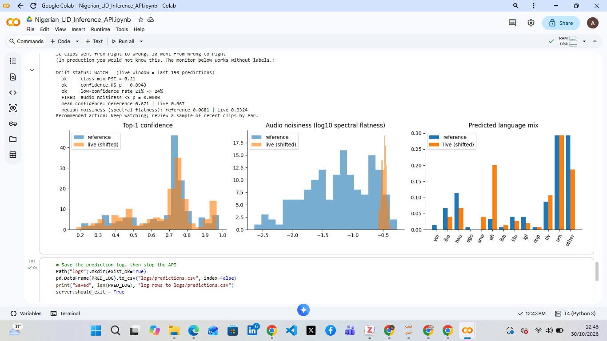

# Nigerian Language ID: Inference API with Drift Monitoring

A FastAPI service that serves a fine-tuned **WavLM** speech model for **Nigerian language identification** (13 classes), logs every prediction, and runs a **label-free drift monitor** that warns when incoming audio stops resembling what the model was validated on.

It builds on the model from the DSN AI Bootcamp 2026 hackathon project: [`AbdulroqeebA/wavlm-base-plus-nigerian-lid`](https://huggingface.co/AbdulroqeebA/wavlm-base-plus-nigerian-lid).

## What it does

| Part | Description |
|------|-------------|
| Inference engine | Loads the model once and applies one shared preprocessing function to every request (16 kHz mono, centre-cropped or padded to 10 s). Uses the GPU when available. |
| API | `GET /health`, `POST /predict` (upload an audio file, get the top 3 languages with confidence, latency and input statistics), `GET /monitor` (recent summary). Every prediction is logged. |
| Reference baseline | Records how the model behaves on 150 clean validation clips. |
| Drift monitor | Compares recent live traffic with the baseline using four signals that need **no labels** (below). |
| Stress test | Sends the same 150 clips again, degraded to phone quality (simulated), and checks whether the monitor notices. |

### Drift signals

| Signal | Flags when |
|--------|-----------|
| Class-mix PSI (rare classes pooled) | PSI above 0.25 |
| Confidence KS test | p-value below 0.01 |
| Low-confidence rate | up by more than 15 percentage points |
| Audio noisiness (spectral flatness) KS test | p-value below 0.01 |

Status is **DRIFT** if 2 or more signals fire, **WATCH** if 1, otherwise **OK**. The thresholds are common rules of thumb, not tuned values.

## Results

Run on a Colab T4 with 300 clips streamed from the validation split (150 reference, 150 live).

**Clean traffic:** status **OK**. PSI 0.11, confidence KS p = 0.14, low-confidence rate 21% to 17%, noisiness KS p = 0.89.

**The same 150 clips, degraded** (band-limited to about 4 kHz plus noise at 5 dB SNR):

| Measure | Clean | Degraded |
|---------|-------|----------|
| Accuracy (labels used only for this check) | 69.3% | 52.0% |
| Clips right to wrong / wrong to right | | 36 / 10 |
| Mean model confidence | 0.669 | 0.667 |
| Median spectral flatness (noisiness) | 0.068 | 0.332 |
| Drift status | OK | **WATCH** |

Only the **audio-noisiness** signal fired. Model confidence, the low-confidence rate (21% to 24%) and class-mix PSI (0.21) stayed under their thresholds.

**Inference latency (median per clip, inside the engine):** about 1,967 ms on CPU, **63 ms on GPU** (worst case 132 ms). This excludes the file upload and network round trip.

### What this shows

- Accuracy dropped about 17 points while the model's **confidence did not change**. A monitor that only watched confidence would have missed it, so the input-level signal earned its place.
- Because the degraded run reuses the same clips as the clean run, the drop is attributable to the degradation and not to a different sample of clips.
- An early version compared different clips and used unpooled PSI. PSI on clean traffic reached 0.24, close to the alarm line, which is why rare classes are pooled and the comparison is paired.

## Limitations

- The distribution shift is **simulated**. No real production traffic was monitored.
- With 150 clips per window and 13 classes, PSI is noisy. Thresholds were not tuned on separate data.
- The noisiness signal also fires when recording conditions change in harmless ways (a different microphone, for example), so a WATCH means "investigate", not "the model failed".
- The status stayed at WATCH, not DRIFT, because only one signal fired. The two-signal rule was set before the run and was not adjusted afterwards.
- The underlying model is a baseline (validation macro F1 about 0.59), see its [model card](https://huggingface.co/AbdulroqeebA/wavlm-base-plus-nigerian-lid) for its limits.

## Run it

1. Open the notebook in Colab with the badge above and choose **Runtime → Change runtime type → T4 GPU** (CPU also works).
2. Add a Hugging Face token as a Colab secret named `HF_TOKEN` (🔑 tab, notebook access on). Never paste a token into the code.
3. Choose **Runtime → Run all**. Streaming the clips takes a few minutes.

## Next steps

- Act on a DRIFT status: collect and label recent clips, retrain with matching augmentation, compare macro F1 on a fixed test set, publish as v2.
- Evaluate on real phone recordings instead of simulated degradation.
- Package the API as a standalone service (Docker) outside the notebook.

## Credits and licenses

- **Author:** [Abdulwahab Abdulroqeeb Opeyemi](https://www.linkedin.com/in/abdulwahababdulroqeeb/).
- **Model:** trained by the hackathon team at the DSN AI Bootcamp 2026 (see the model card for the full team).
- **Pattern:** the inference-engine and monitoring ideas are adapted from DSN AI Bootcamp 2026 sessions on real-time inference (Olalekan Akinsande) and self-healing ML systems (Rashidat). The speech application, API, drift signals and experiments here are new work.
- **Base model:** [microsoft/wavlm-base-plus](https://huggingface.co/microsoft/wavlm-base-plus).
- **Dataset:** [Data-Science-Nigeria/dsn-2026-lid-train](https://huggingface.co/datasets/Data-Science-Nigeria/dsn-2026-lid-train), with mixed per-source licenses. No audio is redistributed in this repository.
- **Code license:** MIT.
